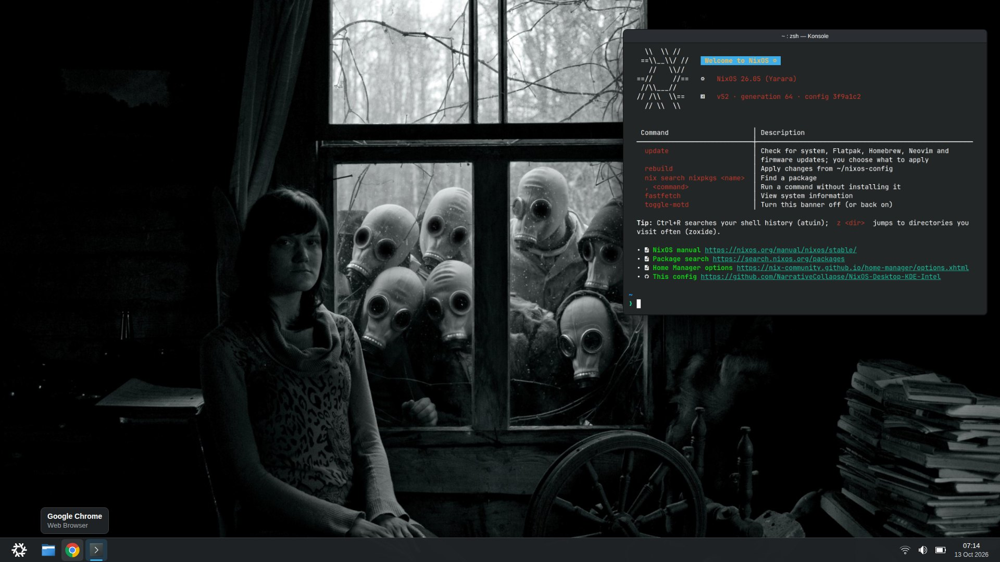
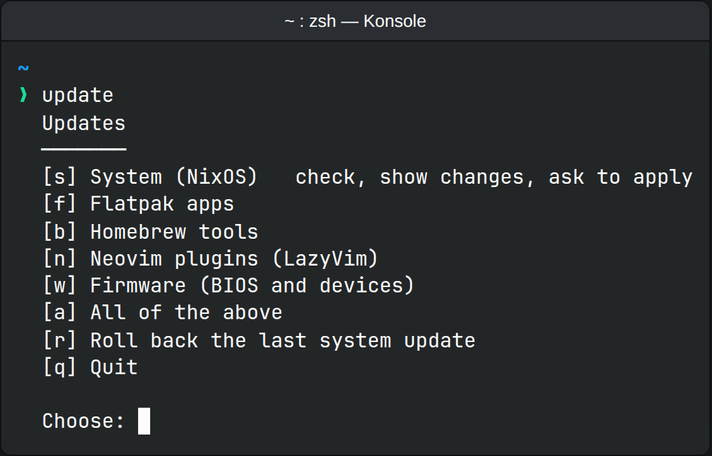
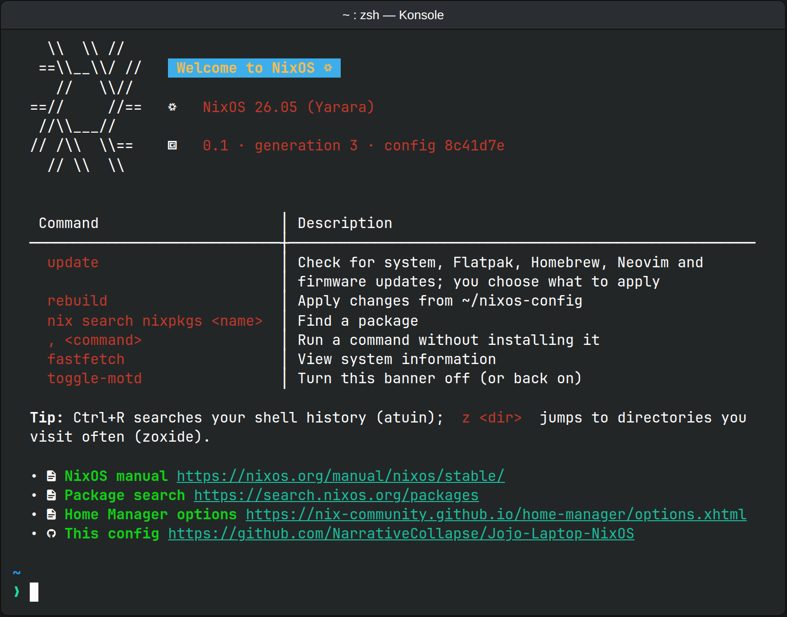
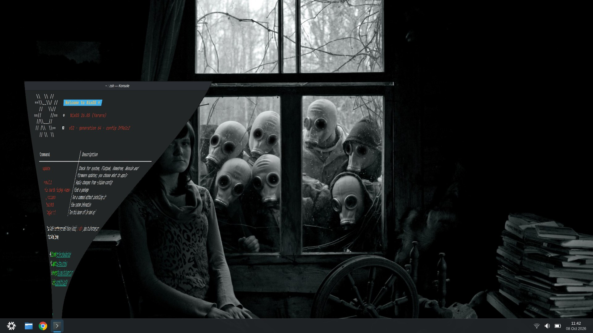

# Jojo-Laptop-NixOS

Austin's flake-based NixOS 26.05 + Home Manager config for **jojo**, an
Acer gaming laptop running Plasma 6:

| Part | What it is | How the config handles it |
| --- | --- | --- |
| CPU | Intel Core i7-13620H (Raptor Lake, 6 performance + 4 efficiency cores) | Intel microcode updates, thermald, power profiles; CachyOS's kernel, compiled for this CPU generation (see [Kernel](#kernel-cachyos)) |
| Graphics | Intel UHD Graphics and an NVIDIA GeForce RTX 4060 Laptop GPU (8 GB) | The Intel GPU runs the desktop; the RTX 4060 runs Steam and games and powers off otherwise (see [NVIDIA graphics](#nvidia-graphics)) |
| Screen | 1920×1080, 144 Hz | Plasma normally picks 144 Hz by itself (`hardware-check` says) |
| Memory | 16 GB | zram swap (compressed in RAM) and oomd |
| SSD | 512 GB NVMe (WD PC SN740) | Erased by the installer and encrypted (LUKS2), TRIM passed through |
| Battery | | Charging stops at 80% (see [Battery charge limit](#battery-charge-limit)) |
| USB drives | WD My Passport 2 TB, WD Game Drive 4 TB SSD, Toshiba 1 TB | Mount as they are (NTFS or exFAT); see [Gaming](#gaming) for Steam games on them |
| Board | Acer "RPL Sportage_RTH" | BIOS settings for the install in [Before you install](#before-you-install) |

It's a copy of
[NixOS-Desktop-KDE-Intel](https://github.com/NarrativeCollapse/NixOS-Desktop-KDE-Intel),
the config for shitbox (an HP laptop), adapted to this hardware: the same
apps, desktop, update menu and backups, plus the NVIDIA GPU. Changes made
to one repository don't reach the other by themselves.

**Current version: 0.7** (git tag `0.7`). See [Versions](#versions).



<sub>An example of the desktop this config sets up: Breeze Dark, the default
wallpaper, the welcome banner in Konsole, the white NixOS snowflake as the
app launcher, Google Chrome pinned to the taskbar, the taskbar docked to
the bottom edge (not floating), and the 24-hour clock with a
military-style date. It's a rendered mockup, not a photo of the laptop; the real
taskbar icons, tray and exact layout may differ.</sub>

## Quick start

1. **Install.** jojo still runs Windows: first go through
   [Before you install](#before-you-install) (copy your files off, update
   the BIOS, two BIOS settings), then boot the
   [installer ISO](#reinstalling-the-installer-iso) and run **Install
   jojo**. It erases Windows. On a laptop already running NixOS: [clone
   and rebuild](#install).
2. **Set up backups once:** `backup-setup` (with the USB backup drive
   plugged in), then `backup-test`. Until then nothing is backed up. After
   that, plugging in the drive is all it takes. See [Backups](#backups).
3. **Check the hardware:** run `hardware-check`, then go through the
   [hardware checklist](#hardware-checklist) (15 minutes).
4. **Day to day:** `update` checks for updates and asks before applying
   anything; after editing the config, `rebuild`. If an update breaks
   something, pick the previous version in the boot menu, or run
   `update-rollback`. More in [Everyday use](#everyday-use).
5. **Changing the config:** [Layout](#layout) says which file covers what.

Everything below is reference: read the part you need.

## What's in it

- **Desktop:** Plasma 6 on SDDM, Wayland only (X11 apps run through
  Xwayland), in Breeze Dark; PipeWire; declarative Flatpak apps from Flathub
  (Chrome, VLC, Flatseal, qBittorrent, Bazaar, Telegram, ZapZap for
  WhatsApp); KCalc, ISO Image Writer,
  Filelight and Partition Manager added to Plasma's own apps (as Nix
  packages; see [KDE apps](#kde-apps)); Plasma/Konsole
  settings in the config (plasma-manager); extra wallpapers built into the
  system, with one set on the desktop, lock and login
  screens; Bluetooth via Plasma's BlueDevil; printing with automatic
  network-printer discovery (Avahi/mDNS); Noto + JetBrains Mono Nerd Font;
  24-hour time throughout; minimized windows pour into the taskbar with
  Magic Lamp, the macOS-style genie effect (see
  [Plasma settings](#plasma-settings)).
  Plasma defaults nothing here uses are left out (see `modules/desktop.nix`):
  the Orca screen reader and text-to-speech, the KDE PIM backend (Akonadi),
  the X11 session, Elisa, the Help Center, the remote desktop server, the
  QR scanner, the on-screen touch keyboard and Discover (Bazaar is the app
  store; see [Flatpak apps](#flatpak-apps)).
- **Hardware:** [CachyOS's kernel](#kernel-cachyos) (its LTS line, built
  for x86-64-v3) instead of NixOS's own, systemd-boot with the boot-menu
  editor locked, a graphical
  Breeze boot splash that also shows the disk password prompt (Plymouth),
  systemd initrd, LUKS with TRIM passed through to the SSD, zram swap with the
  kernel tuned for it (as on Fedora and Pop!_OS), systemd-oomd closing a
  runaway app before memory pressure freezes the desktop,
  power-profiles-daemon (power saver on battery, balanced on AC) +
  thermald, fwupd, smartd watching the SSD's health
  (see [Failure alerts](#failure-alerts)), and Intel VA-API/QSV drivers so
  video decodes on the GPU. The NVIDIA RTX 4060 runs NVIDIA's open kernel
  driver as PRIME render offload: the Intel GPU drives the desktop and the
  RTX 4060 is powered off until something runs on it (see
  [NVIDIA graphics](#nvidia-graphics)). Charging stops at 80%, to keep
  the battery healthy (see [Battery charge limit](#battery-charge-limit)),
  and `hardware-check` runs the [hardware checklist](#hardware-checklist)'s
  checks that a script can do. Closing the lid suspends on battery and does
  nothing on AC. A Memtest86+ entry at the bottom of the boot menu tests
  the RAM, the first suspect when crashes look random. External drives
  formatted NTFS (Windows) or exFAT (cameras, phones, most flash drives)
  mount read-write, and Partition Manager can format and repair them.
- **Network & security:** NetworkManager with systemd-resolved, Mullvad VPN
  (official module), firewall on with only mDNS (UDP 5353, for printer
  discovery) open, and hardening sysctls for
  untrusted Wi-Fi. `sudo` is [sudo-rs](https://github.com/trifectatechfoundation/sudo-rs),
  a memory-safe rewrite (Ubuntu 26.04 LTS's default): the same command,
  remembering your password for 15 minutes. Typing the password shows a
  `*` per key; `sudo -E` isn't supported. Shell shortcuts like `sudo !!`
  work as before (zsh expands them). CAC smart cards work in LibreWolf
  with a USB reader (see [Smart cards (CAC)](#smart-cards-cac)).
- **Gaming:** Steam (and every game it starts) on the RTX 4060, with
  NVIDIA Dynamic Boost on AC, Proton-GE available as a compatibility tool,
  NTSYNC (the kernel's Windows-style thread synchronization, which Proton
  uses), split-lock throttling off as on the Steam Deck, GameMode (which
  pins a game to the CPU's performance cores), MangoHud, and xpadneo for
  Xbox controllers over Bluetooth (see [Gaming](#gaming)).
- **Sound:** EasyEffects (a Flatpak) for an equalizer and effects on the
  speakers, headphones and microphone, as SteelSeries Sonar did on
  Windows.
- **Shell & tools:** zsh + Starship with a Bazzite-style terminal (welcome
  banner, branded fastfetch, eza/atuin/zoxide/direnv and friends; see
  [Terminal](#terminal-bazzite-style)), Neovim with
  [LazyVim](#neovim-lazyvim), git, Podman (Docker-compatible) + distrobox
  with BoxBuddy (a window for managing boxes), LibreWolf.
- **Maintenance:** flakes only (no Nix channels; `nix-shell -p` and
  `<nixpkgs>` use the same nixpkgs as the system), nh for rebuilds and
  weekly cleanup (keeps 14 days and at least 5 generations), weekly store
  deduplication, daily restic backups of
  `/home` (needs the one-time setup below) with a desktop warning when they
  go stale, and GitHub Actions that build every push (see [CI](#ci)).
  Disk-full protection: if free space drops below 5 GB while Nix is
  downloading or building, it deletes unused store paths (never the
  generations in the boot menu) until 10 GB are free. A service that hangs
  at shutdown is given 45 seconds instead of 90, as on Fedora.
- **Updates:** nothing updates on its own. `update` checks the system,
  Flatpak apps, Homebrew tools and Neovim plugins, shows what would change,
  and applies it only when you say yes, and a notification reminds you
  once the system's packages are two weeks old (see [Updates](#updates)).

## What protects what

Each protection here answers a specific risk. If a risk you care about
isn't in the table, nothing covers it yet.

| Risk | Covered by | Where |
| --- | --- | --- |
| Laptop lost or stolen | Full-disk encryption (LUKS2); the boot-menu editor is locked, so nobody can boot a root shell from it | `hosts/jojo/`, `modules/hardware.nix` |
| Losing your files (dead SSD, deletion, theft) | Restic backups of `/home` to a USB drive, as soon as it's plugged in and daily while it stays connected, with a warning when they go stale; smartd warns when the SSD starts failing | `modules/backup.nix`, `modules/hardware.nix` |
| A bad update | Updates only when you choose, with a preview; the last 10 versions stay in the boot menu to go back to; CI builds and boot-tests every change first, and a failure opens a GitHub issue | [Updates](#updates), [CI](#ci) |
| Falling behind on security fixes | A notification once the running system's packages are more than 14 days old | [Updates](#updates) |
| The system breaking with no update (crash, full disk) | oomd closes a runaway app before the desktop freezes; Nix frees store space when the disk runs low; capped journal; Memtest86+ for suspect RAM | `modules/hardware.nix`, `modules/base.nix` |
| A battery worn out early (a gaming laptop often lives on the charger) | Charging stops at 80% | [Battery charge limit](#battery-charge-limit) |
| A tampered or changed package | Every input pinned in `flake.lock` by hash; packages come from the signed NixOS binary cache, except the kernel, which comes from the CachyOS kernel's own signed cache (see [Kernel](#kernel-cachyos) for what that trusts) | `flake.lock`, `modules/cachyos-cache.nix` |
| Hostile Wi-Fi | Firewall with only mDNS open; ICMP redirects and source routing ignored; Mullvad VPN | `modules/network.nix` |
| Tracking while browsing | LibreWolf (privacy-hardened Firefox) as the default browser; Mullvad hides your IP | `modules/desktop.nix` |
| A malicious or buggy app | Flatpak apps run sandboxed (Flatseal to tighten them); `sudo` is sudo-rs (memory-safe) | [Flatpak apps](#flatpak-apps) |
| Firmware vulnerabilities | fwupd installs BIOS and device firmware from the LVFS, when the vendor publishes it (Acer rarely does: update the BIOS from Windows before installing) | `update` [w], [Before you install](#before-you-install) |
| Forgetting what changed | The config is in git: every system version is a commit and a tag; the welcome banner says when the laptop has commits GitHub doesn't | [Versions](#versions) |

**Not covered:** a second, off-site copy of the backups (a fire or burglary
can take the laptop and the USB drive together), Secure Boot (someone with
the laptop in hand could tamper with the unencrypted boot partition to
capture the disk password), and anything beyond what Flatpak's sandbox and
normal Linux user separation provide against malware.

## Layout

```
flake.nix                        inputs, config version, HM wiring, checks, devShell
Brewfile                         yt-dlp, the one tool from Homebrew (see Homebrew below)
statix.toml                      statix lint config
wallpapers/                      extra wallpapers installed system-wide
CLAUDE.md                        rules for AI-assisted changes (checks, versioning)
docs/screenshots/                images used in this README
.github/actions/setup-nix/       CI setup shared by the workflows (disk space + Nix)
.github/actions/ci-issue/        CI: a failure opens a GitHub issue, a pass closes it
.github/workflows/
  check.yml                      CI: nix flake check (incl. VM boot test), no evaluation
                                 warnings, full system build
  next-release.yml               the same checks against the next NixOS release (weekly)
  tag.yml                        CI: tags each new version (0.3, 0.4, …)
  install-test.yml               CI: installs jojo with install-jojo in VMs and boots it
  iso.yml                        test-builds the installer ISO (run by hand)
  update-flake-lock.yml          flake.lock update pull request (run by hand)
hosts/jojo/
  configuration.nix              host: hostname, stateVersion, imports, TRIM on LUKS
  hardware-configuration.nix     generated by the installer; LUKS + ext4 root + EFI boot
                                 (until the install, a placeholder with the same layout)
hosts/installer/
  configuration.nix              the installer ISO: live Plasma + `install-jojo`
modules/
  base.nix                       nix settings, nh + GC, locale, unfree packages option
  kernel.nix                     the CachyOS kernel (which variant)
  cachyos-cache.nix              its binary cache (address and key)
  hardware.nix                   boot, Plymouth splash, zram + oomd, power, battery limit,
                                 lid, driver options, firmware, disk health, graphics,
                                 Bluetooth, `hardware-check`
  network.nix                    NetworkManager, resolved, Mullvad, mDNS, firewall,
                                 network hardening
  desktop.nix                    Plasma 6/SDDM, wallpapers, apps (KDE + LibreWolf),
                                 Flatpak, PipeWire, fonts, printing
  gaming.nix                     Steam (on the RTX 4060), Proton-GE, gamescope, GameMode,
                                 MangoHud, xpadneo
  nvidia.nix                     the RTX 4060: open driver, PRIME offload, power management
  users.nix                      user, sudo (sudo-rs), zsh, podman + distrobox + BoxBuddy,
                                 command-line system packages
  backup.nix                     restic job for /home (needs one-time setup)
  homebrew.nix                   Homebrew PATH, completions, `brew-update`
  notifications.nix              `notify-desktop` + `notify-failure@`: desktop alerts from services
  updates.nix                    `update` menu: system, Flatpak, Homebrew, Neovim, firmware;
                                 the overdue-updates reminder
  smartcard.nix                  CAC readers: pcscd, OpenSC in LibreWolf, `cac-setup`
home/austin/home.nix             zsh, starship, git
home/austin/bling.nix            Bazzite-style MOTD, fastfetch, CLI tools + aliases
home/austin/plasma.nix           Plasma/KDE settings via plasma-manager (Konsole profile)
home/austin/neovim.nix           Neovim + the tools LazyVim needs; links ~/.config/nvim
home/austin/nvim/                the LazyVim config itself (~/.config/nvim), with
                                 lazy-lock.json pinning every plugin
tests/boot.nix                   VM boot test, run by `nix flake check` and CI
tests/install.nix                installer test: install-jojo end to end in VMs (CI)
scripts/                         the longer shell scripts, as plain bash (see below)
  update.sh, update-system.sh    the `update` menu and its [s] System part
  update-neovim.sh               [n] Neovim plugins
  backup-setup.sh, backup-test.sh
  cac-setup.sh                   imports the DoD certificates into LibreWolf
  brew-update.sh                 [b] Homebrew
  install-jojo.sh                the installer ISO's installer
  hardware-check.sh              `hardware-check`
  nixos-motd.sh                  the welcome banner
  lib/confirm.sh                 the shared yes/no prompt
  bump-version.py                version bump used by `update` and the update workflow
  check-eval-warnings.sh         CI: fail if evaluating the system prints a warning
  next-release.sh                CI: which branches "the next NixOS release" means now
  tag-versions.sh                CI: tags the commit that set each version
```

**Where things go.** Each module covers one topic, and anything tied to a
feature lives with it, including its Home Manager settings (MangoHud sits in
`gaming.nix`, the wallpaper settings in `desktop.nix`). `home/austin/` holds
the personal setup: shell, git, editor, terminal look and Plasma. Scripts
longer than about 20 lines are plain bash files in `scripts/`; the module
that installs one reads it with `builtins.readFile` and passes in the few
values it needs from the config as environment variables (`runtimeEnv`, for
example `CONFIG_FLAKE` for the config path). The build runs shellcheck on
every script. Shorter scripts stay inline in their module.

## Before you install

The installer erases the whole SSD, Windows included. Before that, while
Windows still runs:

1. **Copy off everything you want to keep** (Documents, Desktop, Downloads,
   Pictures, game saves that aren't in the cloud) to one of the USB drives.
   Windows' license is stored in the laptop's firmware, so Windows can be
   reinstalled later from Microsoft's download page if you ever need it.
2. **Update the BIOS.** Acer's BIOS updates are Windows programs, and
   Acer rarely publishes them where Linux's firmware updater (fwupd) looks.
   On Acer's support site, enter the serial number (on the sticker under the
   laptop), open **Drivers and Manuals → BIOS/Firmware**, and run the
   newest one. Newer BIOSes fix suspend, fan and GPU-switching bugs that
   Linux runs into too.
3. **Make the installer USB stick:** see
   [Reinstalling](#reinstalling-the-installer-iso) for getting the ISO. On
   Windows, write it with Rufus in **DD Image** mode.
4. **Eject the USB drives** (Safely Remove) and shut down with
   **Shift + Shut down**, so Windows' Fast Startup doesn't leave NTFS drives
   marked "in use" (if one won't mount on NixOS later,
   `sudo ntfsfix -d /dev/sdX1` clears it). Leave them unplugged until
   NixOS is installed: the installer's disk list then has only the SSD.

Then in the **BIOS** (press **F2** repeatedly right after powering on):

1. **Main → F12 Boot Menu → Enabled.** Acer laptops ship with the boot
   menu turned off.
2. **Security → Set Supervisor Password.** Acer only lets you change
   Secure Boot once one is set. Write it down.
3. **Boot → Secure Boot → Disabled.** NixOS's boot loader isn't signed for
   Secure Boot, so with it on, the installer USB won't start.
4. Optionally, **Security → Set Supervisor Password** again with an empty
   new password, to remove it (Secure Boot stays off).
5. **F10** saves and restarts.

To boot the installer, plug in the stick, power on and tap **F12**, then
pick the USB stick. The live system leaves the NVIDIA GPU alone (its
open-source driver, the usual cause of freezes and black screens on the
way to the live desktop, is turned off; the installed system uses NVIDIA's
own). If it still freezes, start again and pick **No modesetting** from
the stick's boot menu options. If the
installer's disk list doesn't show the 512 GB
SSD, the BIOS has Intel VMD (RST) on: on the BIOS's Main tab, press
**Ctrl+S** to show hidden options and set **VMD Controller** to
**Disabled** (older Acer BIOSes call it **SATA Mode**: set **AHCI**).

## Install

```bash
# The rebuild aliases and nh (NH_FLAKE) expect the checkout at ~/nixos-config.
git clone https://github.com/NarrativeCollapse/Jojo-Laptop-NixOS.git ~/nixos-config
cd ~/nixos-config

# Evaluate the whole system (`nix flake check` without --no-build also
# formats, lints and boot-tests it in a VM, which takes a few minutes).
nix flake check --no-build

sudo nixos-rebuild switch --flake .#jojo
```

## Reinstalling: the installer ISO

The flake also builds a USB installer: a live Plasma desktop that installs
this exact config on a fresh (or the same) laptop.

**Get it** either way:

- **Download from GitHub:** Actions tab → **Build installer ISO** → **Run
  workflow**. When it finishes (15–30 minutes), the run's page has an
  `installer-iso` download (a zip with the `.iso` and its `SHA256SUMS`),
  kept for 7 days.
- **Build it yourself** on any machine with Nix; the laptop is the easiest:

  ```bash
  nix build ~/nixos-config#installer-iso
  ls result/iso/        # jojo-installer-<version>.iso, about 3 GB
  ```

Write it to a USB stick (8 GB or more) with **ISO Image Writer** (in the
app menu on jojo, or shitbox), Rufus in **DD Image** mode on Windows, or
any "DD mode" USB writer, then boot from it (**F12** for the boot menu on
Acer laptops, once it's enabled in the BIOS; see
[Before you install](#before-you-install)).

**What's on it:**

- A live Plasma session, logged in automatically (no password).
- **Wi-Fi that works from the panel.** On the official NixOS live USB, only
  `nmtui` in a terminal could connect: the panel's network applet saves
  Wi-Fi passwords in KWallet, which can't unlock in a password-less live
  session. Here KWallet is off, so the applet works. Wi-Fi is also
  unblocked at boot (some laptops start with it soft-blocked), all
  firmware is included, and `nmtui` still works as a fallback.
- A copy of this config (the version it was built from), used only if
  GitHub can't be reached during the install.
- **Install jojo** on the desktop (or `sudo install-jojo` in Konsole).

**What `install-jojo` does**, asking before anything destructive (CI
runs all of it in VMs on every push; see [CI](#ci), Installer test):

1. Checks the internet connection (packages download during the install)
   and opens `nmtui` if there's none, and that the CachyOS kernel's
   download server answers (if not, it asks before going on: the install
   would compile the kernel, an hour or more).
2. Lists the disks, never including the USB stick itself. You type the disk
   to install on, then type its name again to confirm erasing it.
3. Asks for the disk-encryption password (twice); it's asked at every boot.
4. Erases the disk: a 2 GB EFI boot partition (room for two kernels per
   version; see [Kernel](#kernel-cachyos)), and the rest LUKS2-encrypted
   ext4, the same layout as now.
5. Generates `hardware-configuration.nix` for the machine and puts the
   config in `/home/austin/nixos-config`: the latest from GitHub, or the
   copy from the USB stick if GitHub can't be reached. The new hardware
   configuration is committed there (push it after logging in to GitHub on
   the laptop: `cd ~/nixos-config && git push`). The generic files
   `nixos-generate-config` leaves in `/etc/nixos` are removed, since the
   system is built from `~/nixos-config`.
6. Installs the system with `nixos-install --flake`.
7. Asks for austin's login password, then offers to reboot.

**Only if it had to use the USB copy** (GitHub unreachable during the
install), connect `~/nixos-config` to GitHub once after the first login:

```bash
cd ~/nixos-config
cp hosts/jojo/hardware-configuration.nix /tmp/hw.nix
git fetch origin
git reset --hard origin/main          # the latest config from GitHub
cp /tmp/hw.nix hosts/jojo/hardware-configuration.nix
git commit -am "hosts/jojo: hardware configuration after reinstall"
rebuild
```

Pushing (`git push`) needs a GitHub login on the laptop (until it's done,
the welcome banner says how many commits aren't on GitHub yet):
`, gh auth login` then `, gh auth setup-git` (the `,` runs the GitHub CLI
without installing it).

Then restore your files from the backup drive (see [Backups](#backups)).

## Everyday use

| Task | Command |
| --- | --- |
| Rebuild after editing | `rebuild` or `nh os switch` (works from any directory) |
| Update the system, Flatpaks, Homebrew tools, Neovim plugins or firmware | `update`, then pick (see [Updates](#updates)) |
| Roll back a bad rebuild | `sudo nixos-rebuild switch --rollback`, or pick an older entry in the boot menu |
| Format the tree | `nix fmt` |
| Lint, evaluate and boot-test in a VM | `nix flake check` (a few minutes; see below) |
| Create, open or remove a distrobox (another distro's apps and packages) | **BoxBuddy** in the app menu, or `distrobox create`/`enter` |
| Steam with MangoHud + GameMode | `steam-hud` (toggle the overlay with Right Shift + F12) |
| Run an app on the RTX 4060 | `nvidia-offload <command>`, or for good: right-click it in the app menu → **Edit Application…** → **Advanced Options** → tick **Run using dedicated graphics card** |
| What's using the RTX 4060? | `nvidia-smi` (see [NVIDIA graphics](#nvidia-graphics)) |
| Run a game with Proton-GE | In Steam: right-click the game → Properties → Compatibility → tick "Force the use of…" → pick **GE-Proton** |
| See boot messages behind the splash | Press **Esc** during boot |
| Check the SSD's health | `disk-health` (sudo password) |
| Check the hardware (GPUs, screen, battery, sleep, Wi-Fi, sound, failed services) | `hardware-check`, in Plasma with Steam closed (see [Hardware checklist](#hardware-checklist)) |
| Charge to 100% once (for a trip) | `echo 0 \| sudo tee /sys/bus/wmi/drivers/acer-wmi-battery/health_mode` (back to 80% at the next boot) |
| Use a CAC (one-time setup) | `cac-setup`; see [Smart cards (CAC)](#smart-cards-cac) |
| Which commit is running? | `nixos-version --configuration-revision` |
| Which config version is running? | Shown in the welcome banner, `fastfetch`, and the boot menu entry (e.g. `0.3-26.05…`) |

`nix flake check` fails on unformatted files, statix/deadnix findings, a
README whose "Current version" doesn't match `version` in `flake.nix`, a
configuration that doesn't evaluate, or a failed boot test.
`hosts/jojo/hardware-configuration.nix` is exempt from formatting and
linting because regenerating it would undo any changes.

**The boot test** (`tests/boot.nix`) starts this exact configuration in a
QEMU VM and checks that it reaches the desktop: NetworkManager, DNS,
Mullvad, mDNS, oomd, the backup timer and Home Manager are running,
Plasma logs in for austin, the taskbar script has run, the Plasma settings
(Magic Lamp, power profiles) are written, the update reminder reads the
packages' date, and `update`, `nixos-motd`, `hardware-check` and the
other commands work, with the right version label, and the welcome banner
points out config commits that aren't on GitHub.
It checks that the NVIDIA driver is built for the running kernel and
that Steam starts on it (the VM has no NVIDIA GPU, so the driver itself
can't run there), and that the battery charge limit's driver is installed
and set to turn it on (the VM has no Acer battery either). It also plugs in a blank virtual disk as the backup drive and checks that
a real backup of `/home/austin` runs by itself, and formats another as NTFS
and exFAT and writes to each. Only the VM's differences are overridden (no
encrypted disk, automatic login, 4 GB of memory, the two blank disks). Things a VM can't have aren't tested: Wi-Fi,
Bluetooth, SMART disk data, firmware updates and anything needing the
internet. Run it alone with `nix build .#checks.x86_64-linux.boot -L`, or
watch the VM with `nix run .#checks.x86_64-linux.boot.driverInteractive`
(then `start_all()` at its prompt).

Neovim is LazyVim; its keys are in [Neovim (LazyVim)](#neovim-lazyvim).

## Updates

Nothing updates on its own. Run `update` (it's in the welcome banner)
whenever you want to check:



Or skip the menu: `update system`, `update flatpak`, `update brew`,
`update neovim`, `update firmware`, `update all`, `update rollback`. Each part asks before it
changes anything.

- **[s] System** (`update-system`, in `modules/updates.nix`):
  1. Runs `git pull` in `~/nixos-config`, so changes pushed from elsewhere
     come first. It stops if `flake.lock`, `flake.nix` or `README.md` has
     uncommitted edits, and if this checkout has commits GitHub doesn't
     (such as the hardware configuration from the install), it says how to
     combine them (`git pull --rebase && git push`).
  2. Runs `nix flake update`. If nothing is newer, it says so and stops.
  3. Bumps the config version (`flake.nix`, the README's "Current version"
     and a Versions row naming the updated inputs) and commits it locally.
  4. Checks that the update's kernel is available prebuilt from its cache
     (see [Kernel](#kernel-cachyos)); if not, it stops and undoes the
     commit rather than compile a kernel for an hour. Then builds the new
     system without activating it, and lists every package whose version
     changes, plus the change in total size (`nvd`).
  5. Asks how to apply it (sudo password for the first two):
     - **[n] Now** switches the running system over.
     - **[r] At the next restart** installs it as the default boot entry
       but leaves the running desktop alone, so the new version starts
       fresh. Use it for big updates (a new Plasma or NixOS release), where
       switching a running session can leave apps misbehaving until you
       log out. Until the restart, `update` [s] says a version is waiting.
     - **[s] Skip**: the commit is undone and the repo is exactly as it
       was. The same happens if anything fails or is interrupted (Ctrl+C)
       before the update is applied, so a failed `update` never leaves
       `flake.lock` half-changed.

     After [n] or [r] it pushes the commit to GitHub, where the
     [Tag versions](#ci) workflow tags it with the new version.

  If pushing fails (for example, no GitHub login on the laptop), the update
  is still applied, it prints the command to push later, and the welcome
  banner reminds you until it's pushed.

  plasma-manager is the one input `update` doesn't move: it's pinned to a
  commit (see [Plasma settings](#plasma-settings)).
- **[f] Flatpak** runs `flatpak update`, which lists pending updates and
  asks before installing them. System-wide apps may ask for your password.
- **[b] Homebrew** (`brew-update`, in `modules/homebrew.nix`) installs
  Homebrew the first time (after asking), runs `brew update`, then lists
  formulas that are missing, outdated, or installed but not in the
  Brewfile, and installs, upgrades and removes them to match only on a
  yes.
- **[n] Neovim** (`update-neovim`): after a `git pull` and a yes, updates
  LazyVim and its plugins (`:Lazy sync`), lists the plugins that changed,
  and commits and pushes the new pins in `home/austin/nvim/lazy-lock.json`.
  See [Neovim (LazyVim)](#neovim-lazyvim) for going back.
- **[w] Firmware** (`update-firmware`) asks fwupd for BIOS and device
  firmware updates from the LVFS, and `fwupdmgr update` asks before
  installing and before any reboot. Acer publishes firmware there for few
  laptops, so it usually says there's none; BIOS updates then come from
  Acer's support site, as Windows programs (see
  [Before you install](#before-you-install)).
- **[r] Roll back** (`update-rollback`) lists the last few system versions
  and, after a yes, switches back to the one before the current one (the
  same as choosing it in the boot menu, but it stays the default). Your
  `~/nixos-config` still holds the newer version, so the next `rebuild` or
  `update` returns to it; to stay back, undo the change there (for
  example `git revert HEAD`) and push.

Still scheduled, because none of them change what's installed: nh's weekly
cleanup of old generations, weekly store deduplication, the daily backup,
fwupd's refresh of firmware metadata (firmware itself only installs through
`update` [w] or `fwupdmgr update`), and tldr's page cache. The one
notification about updates is the reminder below; Discover, which would
announce every available update, isn't installed.

### Overdue-updates reminder

Once the running system's packages are more than 14 days old, a
notification says **Updates are overdue** and to run `update`. If an
update is already installed for the next restart ([r] above), it says
**Restart to finish updating** instead. It checks 15 minutes after login
and once a day after that, and never installs anything itself.

The age comes from the system's version: `26.05.20260926.5e2305d` means
NixOS packages as of 26 September 2026, so applying `update` [s] resets it.
NixOS publishes new packages every few days; when its channel stalls for
longer (rare, while a failing build is fixed), `update` finds nothing
newer and the reminder keeps coming until it moves.

- Change the threshold with `overdueDays` at the top of `modules/updates.nix`.
- Test it: `systemctl --user start update-reminder`; then
  `journalctl --user -u update-reminder` shows the date it read.
- Silence it until the next login: `systemctl --user stop update-reminder.timer`.

## Release upgrade

NixOS has two releases a year (May and November), and each gets security
updates for about seven months. This config is on **26.05**, which is
supported until the end of December 2026. **26.11** is due in late
November, and moving to it is a deliberate step, not something `update`
does: `update` only moves within the release.

**Already in place, so upgrade day is short:**

- **The Next NixOS release workflow** (`.github/workflows/next-release.yml`,
  every Monday and by hand from the Actions tab) runs the same checks as
  CI, VM boot test included, against the next release instead of the one
  `flake.lock` pins. A renamed option or a removed package fails there
  weeks ahead, while the laptop is unaffected, and a failure opens a
  GitHub issue (see [CI](#ci)). It works out the target itself
  (`scripts/next-release.sh`, reading the release from `flake.nix`): the
  next release's own branches (nixpkgs `nixos-26.11` and Home Manager
  `release-26.11`) as soon as both exist, a few weeks before the release,
  and until then nixos-unstable and Home Manager master, which 26.11 is cut
  from. Each run's summary page says which it used. Unstable occasionally
  breaks for reasons that never reach a release (a package failing to
  build for a few days), so look at why a run failed before acting on it.
  To run the same checks on the laptop (it downloads the next release's
  packages, several GB): `nix flake check $(scripts/next-release.sh)`.
- **CI fails on evaluation warnings.** NixOS warns about a renamed or
  deprecated option for a release before making it an error, so a warning
  today is a broken build at the next upgrade.
- **Known differences are handled for both releases:** the journal's size
  limit is a systemd drop-in file (the journald option changed), Mullvad
  picks its 26.05 or 26.11 setup by itself (26.11 splits the app from the
  daemon), the initrd settings 26.11 rejects aren't set (it only has the
  systemd initrd, 26.05's default), and Plasma's exclusion list names
  `kwin-x11` only where the package still exists.

**Upgrade day** (once 26.11 is out and the Next release run is green):

1. In `flake.nix`, change `nixos-26.05` to `nixos-26.11` and
   `release-26.05` to `release-26.11` (and "26.05" in the description).
   nixpkgs, Home Manager and plasma-manager have to move together.
2. Move plasma-manager's pin to a recent commit that works with 26.11 (it
   has no release branches; the Next release workflow tests its latest
   commit). The other inputs follow nixpkgs and need nothing.
3. Run `nix flake update`, bump the version, then push; CI must be green.
4. Skim the 26.11 release notes' "Backward Incompatibilities" for anything
   that changes behavior without failing a check.
5. On the laptop: `cd ~/nixos-config && git pull && rebuild`, then reboot.
   If something's wrong, pick the previous version in the boot menu, or
   run `update-rollback`.

Leave `system.stateVersion` and `home.stateVersion` at 26.05: they record
the release the laptop was installed with, not the one it runs. The
[CachyOS kernel](#kernel-cachyos) doesn't follow the NixOS release (it
comes from unstable either way), so upgrade day doesn't change it.

Afterwards, tidy up: in `modules/network.nix` keep just
`gui.enable = true;` for Mullvad. The Next release workflow moves on to
27.05 by itself, since it reads the current release from `flake.nix`.

## NVIDIA graphics

`modules/nvidia.nix`. The laptop has two GPUs: the Intel one inside the
CPU, which runs the desktop and the built-in screen, and the RTX 4060,
which is powered off until something runs on it (NVIDIA's PRIME render
offload, with fine-grained power management). That keeps the battery life
close to that of a laptop without one. What runs on the RTX 4060:

- **Steam and every game it starts**, however Steam is opened (see
  [Gaming](#gaming)).
- **Any app you choose:** once, in a terminal, with `nvidia-offload
  <command>` (for example `nvidia-offload blender`); or every time it
  starts: right-click it in the app menu → **Edit Application…** →
  **Advanced Options** → tick **Run using dedicated graphics card**
  (Plasma then launches it on the RTX 4060 from the menu, the taskbar and
  KRunner).
- **An external display on the HDMI port**, on most laptops like this one,
  where that port is wired to the NVIDIA GPU: the GPU stays on while the
  display is connected.

Useful to know:

- **What's on it:** `nvidia-smi` shows the GPU's load, memory, temperature
  and the apps using it. Running it wakes the GPU for a few seconds.
- **Driver:** NVIDIA's open kernel module (what NVIDIA recommends for RTX
  20-series and newer). It comes with the [kernel](#kernel-cachyos), so
  it's the version in nixos-unstable (595.104 at the moment) rather than
  26.05's, and updates with `update` [s] like everything else. The module
  is compiled for the CachyOS kernel on the laptop, and NixOS can't
  redistribute the rest of the driver (it's unfree), so after a kernel or
  driver update the laptop compiles the module and downloads the driver
  from NVIDIA (about 400 MB), which adds a few minutes to that update.
- **Suspend:** the GPU's memory is saved across suspend, so a game left
  running survives closing the lid.
- **Video** is decoded by the Intel GPU (VA-API), in browsers and video
  players alike, so a video doesn't wake the RTX 4060. NVIDIA's own
  video-decoding driver isn't installed.
- **Dynamic Boost** (`nvidia-powerd`): on AC, when a game is limited by the
  GPU, power shifts from the CPU to the GPU, as NVIDIA's Windows driver
  does.
- If the desktop doesn't come up after an update that changed the driver,
  pick the previous version in the boot menu.

## Kernel (CachyOS)

`modules/kernel.nix`. jojo runs [CachyOS](https://cachyos.org)'s kernel
instead of NixOS's own. CachyOS tunes the kernel for desktop and gaming
responsiveness (its patch set, a 1000 Hz timer, full preemption, the ADIOS
disk scheduler, `-O3` builds), and this build is compiled for x86-64-v3,
the instruction set of jojo's CPU generation, rather than for every
x86-64 CPU. It's CachyOS's LTS line, 6.18, the same series NixOS 26.05
uses, so NVIDIA's driver and the add-on drivers (battery limit, Xbox
controller) build against it reliably. Expect smoother frame pacing under
load more than higher FPS. `uname -r` shows the running kernel.

**Where it comes from**, since it's the one part of the system that isn't
from NixOS 26.05:

- The [nix-cachyos-kernel](https://github.com/xddxdd/nix-cachyos-kernel)
  flake builds its kernels from its own pinned copy of
  **nixos-unstable**. So the kernel, NVIDIA's driver and the drivers built
  against the kernel come from unstable; everything else stays on 26.05.
  `update` moves it along with everything else.
- The kernel downloads prebuilt from the flake author's binary cache,
  `cache.lantian.pub`, signed with its own key
  (`modules/cachyos-cache.nix`). Everything else still comes from NixOS's
  own cache first. NVIDIA's module and the small drivers compile on the
  laptop, a few minutes after each kernel update.
- **What that trusts:** a kernel controls the whole machine, so this means
  trusting that cache's owner as much as NixOS itself. In October 2026 his
  servers were broken into through his SSH key; he took them offline,
  reinstalled them, and on 24 October moved the cache to a new address
  with a new signing key, saying no data had been changed. Only the new
  address and key are trusted here.
- **If that cache is down** (it was for nine days that October), Nix would
  compile the kernel itself, an hour or more. `update` checks first and
  stops; the installer checks before erasing anything; CI fails at its
  first step rather than compile.

**NixOS's own kernel is always in the boot menu**: next to each version
there's a second entry marked **nixos-kernel**, the same system with NixOS
26.05's kernel (and the NVIDIA driver that comes with it). If a CachyOS
kernel update stops jojo booting, breaks the desktop, or its cache goes
away, pick that entry. It costs about 1 GB of disk and a few more minutes
on updates that change it. To go back to NixOS's kernel for good (or to
stop trusting the extra cache): in `hosts/jojo/configuration.nix`, delete
the `../../modules/kernel.nix` line, then `rebuild`.

**Other CachyOS variants**, one name to change in `modules/kernel.nix`
(both prebuilt too): `linuxPackages-cachyos-bore-x86_64-v3` adds BORE,
CachyOS's scheduler that favors interactive programs (games, the desktop)
over background work, which the LTS line doesn't have, and
`linuxPackages-cachyos-latest-x86_64-v3` is the newest kernel without it.
Both are CachyOS's newest kernel (7.x), which NVIDIA's driver sometimes
trails.

## Gaming

`modules/gaming.nix`. Steam runs on the RTX 4060 (it's started with
NVIDIA's offload variables), so its games do too, native Linux and Proton
alike. The catch: while Steam is running, even minimized to the tray, the
GPU stays awake. On battery, quit it (Steam menu → **Exit**). `steam-hud`
starts it with the MangoHud overlay (FPS, frame times, CPU and GPU
temperature, and the GPU's name, to confirm it's the RTX 4060; Right
Shift + F12 toggles it) and GameMode.

**Tuned for this CPU and Proton:**

- **GameMode** switches the CPU to its performance governor and pins the
  game to the i7's 6 performance cores, leaving the 4 efficiency cores to
  everything else. It applies to games started under it: everything when
  Steam was opened with `steam-hud`, or one game with `gamemoderun
  %command%` in its Properties → Launch Options (`mangohud gamemoderun
  %command%` adds the overlay). Steam opened from the app menu runs games
  without it.
- **NTSYNC:** the kernel's own version of Windows' thread
  synchronization. Wine 11 and the Protons built on it (GE-Proton 11,
  installed here) use it instead of emulating it, which helps CPU-heavy
  Windows games. Protons built on older Wine may not. To see it in use,
  while a Windows game runs: `ls -l /proc/*/fd 2>/dev/null | grep -c ntsync`
  prints more than 0.
- **Split-lock throttling off:** Intel's 12th-generation and newer CPUs
  detect "split locks" (an atomic memory operation across two cache lines,
  which stalls every core), and the kernel then slows the program on
  purpose. Some Windows games do it all the time and stutter. SteamOS and
  Bazzite turn the throttling off; so does this config.
- **No Steam gamescope session at the login screen:** on a laptop whose
  screen runs on the Intel GPU and whose games run on the RTX 4060, it
  tends to come up black. Big Picture inside Plasma (Steam → View → Big
  Picture Mode) does the same job.

**Steam games on the USB drives.** Valve advises against running Proton
games from an NTFS drive, the format the WD Game Drive (and the other
drives) most likely has from Windows: Proton can't create some of the
files it needs there, so games often fail to start. To play from that
drive, reformat it as ext4 in
Partition Manager (this erases it: copy anything on it elsewhere first),
open it in Dolphin once so it's mounted, and make it yours (a new ext4
drive belongs to root, so Steam couldn't write to it):
`sudo chown austin: /run/media/austin/<its name>`. Then add it in Steam →
Settings → Storage. For Steam to find the library at every login, have
Plasma mount it: System Settings → Disks & Devices → Device Auto-Mount,
tick it under **Login**. The internal SSD's 512 GB
fill up fast with games; `filelight` shows what's using the space.

## Hardware notes

What's specific to this laptop, beyond the [NVIDIA GPU](#nvidia-graphics)
and [Gaming](#gaming):

- **CPU:** the i7-13620H has 6 performance and 4 efficiency cores. The
  kernel's scheduler ([CachyOS's kernel](#kernel-cachyos), with the
  mainline EEVDF scheduler) puts busy threads on the performance cores first
  (from the core rankings the firmware reports), power-profiles-daemon sets how eagerly they boost (power
  saver on battery, balanced on AC), and thermald follows the laptop's own
  thermal tables, the ones Windows uses. `sensors` shows the core and SSD
  temperatures.
- **Acer's performance modes and fans** (NitroSense on Windows): Linux's
  `acer-wmi` driver supports them only on the models it lists, and this
  one isn't listed, so the fans follow the laptop's default mode and
  there's no Performance mode with higher power limits. It can be forced
  on, which often works since Nitro and Predator laptops share Acer's
  interface: in `modules/hardware.nix`, remove the `#` in front of
  `options acer_wmi predator_v4=1` (in `boot.extraModprobeConfig`, with
  the other driver options below), rebuild and reboot. If
  `cat /sys/firmware/acpi/platform_profile_choices` then lists modes, the
  battery icon's power profiles switch Acer's modes (Performance for
  games), and `sensors` shows the fan speeds. If anything misbehaves, put
  the `#` back or boot the previous version. The keyboard's RGB
  lighting has no Linux support either.
- **Thunderbolt:** if the USB-C port is Thunderbolt, a dock or drive asks
  to be authorized in System Settings → Thunderbolt (boltd).
- **Wi-Fi:** which card the laptop has isn't known yet: `hardware-check`
  names it. Intel and MediaTek cards need
  nothing. If it's a **Realtek** card (rtw89, e.g. RTL8852BE) and Wi-Fi
  drops or is slow, turn off its power saving: in `modules/hardware.nix`,
  remove the `#` in front of the two `options rtw89_…` lines, rebuild and
  reboot.
- **Screen flicker** (rare, on some laptop panels with Intel graphics): in
  `modules/hardware.nix`, remove the `#` in front of
  `options i915 enable_psr=0`, rebuild and reboot. It turns off Panel
  Self Refresh, at a small cost in battery life.
- **Suspend:** laptops of this generation usually only have "modern
  standby" (`hardware-check` shows `[s2idle]`), which uses a little more
  battery while asleep than older laptops' deep sleep. If the battery
  drops more than a few percent overnight, check that the RTX 4060 powers
  off (`hardware-check` again) before anything else.
- **Games on an external display:** the HDMI port is most likely wired to
  the RTX 4060, and the desktop is drawn by the Intel GPU, so frames for
  that screen are copied between the GPUs. Most games run fine; if one
  stutters only on the external screen, try it on the built-in one.
- **Sound:** the speakers and microphone use Intel's SOF audio firmware,
  which is included. For an equalizer (Windows had SteelSeries Sonar),
  open **EasyEffects**. A SteelSeries headset works as a normal USB or
  Bluetooth headset; its battery level and sidetone settings need
  HeadsetControl, which isn't installed (it needs its device rules too:
  `services.udev.packages` and `environment.systemPackages` both with
  `pkgs.headsetcontrol`).

## Battery charge limit

In `modules/hardware.nix`. Charging stops at 80%, as Acer Care Center's
battery charge limit does on Windows: a battery kept at 100% on the
charger, as a gaming laptop usually is, loses capacity years sooner. It's
Acer's own "battery health mode", reached through a small extra driver
(acer-wmi-battery, prebuilt in NixOS's cache), which turns it on at every
boot. The Nitro V 15 ANV15-51, most likely this laptop, is on the driver's
list of laptops it works on; `hardware-check` says whether it's on, and if
the driver didn't start, how to find out why.

- **Charge to 100% once**, for a trip (until the next boot):
  `echo 0 | sudo tee /sys/bus/wmi/drivers/acer-wmi-battery/health_mode`
- **Turn the limit off for good:** in `modules/hardware.nix`, change
  `enable_health_mode=1` to `0`, then rebuild.

## Hardware checklist

CI boots the config in a virtual machine, which has no Wi-Fi, Bluetooth,
camera, battery or real GPU. Run through this on the laptop after
installing, after a release upgrade, and when an update touches the kernel
or graphics (an NVIDIA driver update included). It takes about 15 minutes.

Start with **`hardware-check`** in a terminal in Plasma, with Steam closed
and no HDMI display connected. It checks what a script can (the GPUs and
their addresses in `modules/nvidia.nix`, whether the RTX 4060 powers off,
the screen's refresh rate, sleep, the battery's health and charge limit,
Acer's power modes, the Wi-Fi card, Bluetooth, sound, NTSYNC, failed
services), prints each as OK, CHECK (worth a look) or INFO, and saves a
report with the details to `~/hardware-report-jojo-<date>.txt`, to share
when asking for help. It holds no passwords, serial numbers or network
names. Then, by hand (`hardware-check` covers some items already):

- [ ] **Wi-Fi:** connects, and reconnects after suspend.
- [ ] **Suspend and resume:** close the lid on battery, open it: the lock
      screen comes back with Wi-Fi and sound working. Once more with a game
      running: it continues after resume.
- [ ] **Bluetooth:** the Xbox controller pairs and works in a game.
- [ ] **Sound:** speakers, headphone jack, and the volume keys.
- [ ] **Webcam and microphone:** test in Chrome (for example a video call
      test page).
- [ ] **144 Hz:** `hardware-check` says the screen runs at its highest
      refresh rate (or System Settings → Display Configuration shows the
      built-in screen at 1920×1080, **144 Hz**).
- [ ] **NVIDIA GPU:** `hardware-check` says both GPU addresses in
      `modules/nvidia.nix` are right (if not, it prints the real ones to
      put there), and `nvidia-smi` lists the **NVIDIA GeForce RTX 4060
      Laptop GPU**.
- [ ] **The RTX 4060 powers off:** `hardware-check` says it's powered off
      while nothing uses it. If it stays on, try
      `sudo systemctl stop nvidia-powerd` and check again: if that fixes
      it, set `dynamicBoost.enable = false` in `modules/nvidia.nix`.
- [ ] **Battery charge limit:** `hardware-check` says it's on, and on the
      charger the battery stops at 80%.
- [ ] **External display:** HDMI or USB-C shows a picture and can be
      arranged in System Settings → Display Configuration.
- [ ] **Video decoding on the GPU:** a 4K YouTube video plays smoothly in
      Chrome, and `chrome://gpu` lists **Video Decode: Hardware
      accelerated**.
- [ ] **Power profiles:** unplug the charger: the battery icon's popup
      shows **Power Save**; plug in: **Balanced**.
- [ ] **Brightness and keyboard keys:** brightness, mute and media keys
      work. (The keyboard's RGB lighting and Acer's NitroSense fan modes
      have no Linux support in this config.)
- [ ] **Steam:** a game starts (with Proton for a Windows game), and
      `steam-hud` shows the MangoHud overlay, naming the **RTX 4060** at
      its top. While a Windows game runs,
      `ls -l /proc/*/fd 2>/dev/null | grep -c ntsync` prints more than 0
      (Proton is using NTSYNC).
- [ ] **Temperatures:** `sensors` lists the CPU cores; under a game they
      stay below about 95 °C (the CPU's limit is 100 °C).
- [ ] **Printing:** the network printer appears on its own.
- [ ] **External drives:** the WD and Toshiba USB drives (formatted on
      Windows) open in Dolphin and take a new file.
- [ ] **CAC reader** (if you use one): `pcsc_scan` shows the reader and
      reacts when the card goes in, and a CAC site in LibreWolf asks for
      the PIN.
- [ ] **Health:** `disk-health` shows PASSED, and
      `systemctl --failed` lists nothing.

If something fails right after an update, boot the previous version from
the boot menu: if it works there, the update caused it.

## Terminal (Bazzite-style)

`home/austin/bling.nix` recreates [Bazzite](https://github.com/ublue-os/bazzite)'s
terminal the Nix way. Bazzite installs these tools with Homebrew
(`ujust bazzite-cli`) and appends lines to your shell's rc file; here Home
Manager declares all of it. Adapted from Bazzite (Apache-2.0).



<sub>Rendered from the banner script in Konsole's colors; the generation
number is an example.</sub>

- **Welcome banner:** every new terminal shows a small black-and-white
  NixOS logo beside the NixOS version, the system generation and config
  commit, then a table of common commands (starting with `update`), a
  random Nix tip, and links. It's skipped inside containers (distrobox,
  toolbox), since it describes this machine, not the box. `toggle-motd`
  turns it off or back on (same switch file as Bazzite's
  `~/.config/no-show-user-motd`).
- **fastfetch:** Bazzite's layout and icons with the NixOS logo; the first
  line shows the generation and config commit. `neofetch` runs it too.
- **Tools:** `ls`/`ll`/`la`/`lt` use eza (icons, folders first), `grep`
  uses ugrep, Ctrl+R searches history with atuin, `z <dir>` jumps to
  frequent directories (zoxide), `open <file>` opens it in the default app.
  Bazzite's standalone tools are installed too: `tldr`, `tv`, bat, fd,
  ripgrep, gh, glab, jq, yq, dysk, trash-cli, shellcheck and stress-ng
  (from Nix, in `bling.nix`; Bazzite's yt-dlp comes from
  [Homebrew](#homebrew)).
- **direnv + nix-direnv:** add `use flake` to a project's `.envrc`, run
  `direnv allow`, and its `nix develop` shell loads whenever you `cd` in.
- **Command not found → which package:** type a command you don't have and
  the shell lists the nixpkgs packages that provide it. `, <cmd>` (comma)
  runs it straight away without installing, e.g. `, cowsay hi`. Both use
  [nix-index-database](https://github.com/nix-community/nix-index-database)'s
  prebuilt index, so nothing is indexed on the laptop. (Its message suggests
  `nix-env -iA` to install; in this config, add the package to the Nix
  config instead.)
- **Container badge:** when this prompt runs inside a container, Starship
  starts it with 📦 and the container's name, like Bazzite's prompt.
- **Your shell inside distrobox:** `~/.config/distrobox/distrobox.conf`
  shares `/nix/store`, your Home Manager profile and the current system
  (all read-only) with new boxes, so your zsh, prompt, badge and aliases
  load inside them. It applies to boxes created after this change; recreate
  older ones (`distrobox rm <name>`, then `distrobox create …`). This part
  couldn't be tested before release, so treat it as best-effort; if a box
  misbehaves, delete that file's line and recreate the box.
- **BoxBuddy** (in the app menu) does the same with windows and buttons:
  create a box from a list of distro images (optionally with systemd, its
  own home folder or extra shared folders), open a terminal in it, upgrade
  or remove it, install `.deb`/`.rpm` files into it, and export a box's
  apps so they appear in Plasma's app menu. Set Konsole as its terminal
  once (menu → **Set Preferred Terminal**). It only drives distrobox, so
  boxes made either way show up in both, and they get the shared shell
  setup above. It's installed from Nix (`modules/users.nix`), not as a
  Flatpak: the Flatpak's sandbox hides features (custom home folders,
  extra folders, `.deb`/`.rpm` installs) unless you widen its permissions.
  It's a GNOME-style (GTK) app, so it doesn't use the Breeze look.

The icons come from JetBrains Mono Nerd Font. Konsole's default profile is
set by the config to "NixOS", which uses JetBrainsMono Nerd Font Mono so
icons fit the terminal grid (see [Plasma settings](#plasma-settings)). To
drop the whole setup, remove the `./bling.nix` import at the top of
`home/austin/home.nix`.

### Emoji and icons

Color emoji come from Noto Color Emoji. With this config they render in
GTK apps, KDE/Qt apps, Konsole, and LibreWolf, and the Flatpak module
exposes the system fonts (emoji included) to Flatpak apps. If emoji look
wrong somewhere:

- **Text console** (Ctrl+Alt+F3 or before login): the Linux console can't
  draw emoji or Nerd Font icons at all.
- **Black-and-white emoji in one app:** apps that don't handle emoji
  themselves (some older X11, Java or Electron apps) get monochrome emoji
  from DejaVu Sans or Noto Sans Symbols 2 first. Appending Noto Color Emoji
  to the default fonts in `modules/desktop.nix` fixes that, at the cost of a
  few symbols such as ♥ and ✔ also turning into color emoji:

  ```nix
  fonts.fontconfig.defaultFonts = {
    serif = lib.mkAfter [ "Noto Color Emoji" ];
    sansSerif = lib.mkAfter [ "Noto Color Emoji" ];
    monospace = lib.mkAfter [ "Noto Color Emoji" ];
  };
  ```

  `mkAfter` matters: Plasma sets these lists too, and the emoji font must
  come after the text fonts or it would take over digits and `#`.
- **Missing in the banner, prompt, or fastfetch:** rebuild (`rebuild`) and
  open a new terminal.

## Neovim (LazyVim)

Neovim runs [LazyVim](https://www.lazyvim.org): a full IDE-style setup
(file explorer, fuzzy finding, language servers, completion, formatting,
git, a key guide) on top of plain Neovim. It's split the way LazyVim
expects on NixOS:

- **Nix** (`home/austin/neovim.nix`) installs Neovim and the tools LazyVim
  needs on Neovim's own PATH: a C compiler and the tree-sitter CLI (for
  syntax parsers), ripgrep, fd, fzf, lazygit, unzip, the Wayland clipboard,
  and the Nix language tools (the `nil` language server, `nixfmt`,
  `statix`). Neovim stays the default editor (`vi` and `vim` open it).
- **LazyVim** (`home/austin/nvim/`) manages its plugins itself.
  `~/.config/nvim` points straight at that folder in `~/nixos-config`, not
  at a copy in the Nix store, so:
  - edits there apply the next time Neovim starts, with no rebuild;
  - every plugin's exact version is pinned in `lazy-lock.json`, which is
    committed, so a reinstall gets the same versions;
  - extras you turn on with `:LazyExtras` are saved in `lazyvim.json`
    there. Commit them like any other change.

**First start** downloads the plugins and compiles the syntax parsers, so
it needs the internet and takes a minute. After that, nothing updates by
itself: LazyVim's background update check is off, and `update` [n] (or
`:Lazy` inside Neovim) updates plugins when you choose.

**Keys** (leader is Space; press it and wait for a menu of everything):

| Keys | Does |
| --- | --- |
| `Space Space` or `Space f f` | Find files |
| `Space /` or `Space s g` | Search text in the project |
| `Space ,` or `Space f b` | Switch buffer |
| `Space e` | File explorer |
| `Space g g` | lazygit |
| `Space c f` | Format the file |
| `Space l` | `:Lazy`, the plugin manager |
| `Space c m` | `:Mason`, language servers and tools |

The earlier config's `Space f f` and `Space f b` still work; text search
moved from `Space f g` to `Space /`.

**Languages:** LazyVim's defaults cover Lua, Markdown, JSON, YAML and
more, and the Nix extra is on for this repo (highlighting, the `nil`
language server, `nixfmt` on save, `statix` hints). For others, open
`:LazyExtras` and enable one (for example `lang.python`). Mason downloads
most language servers itself; its prebuilt ones run on NixOS through
nix-ld. Ones installed with npm need Node.js: add `nodejs` to
`extraPackages` in `home/austin/neovim.nix` if an extra asks for it.

**Going back** after a plugin update: `cd ~/nixos-config && git revert
HEAD` (or `git checkout <commit> -- home/austin/nvim/lazy-lock.json`), then
`:Lazy restore` in Neovim.

**Settings** go in `home/austin/nvim/lua/config/` (`options.lua`,
`keymaps.lua`, `autocmds.lua`) and extra plugins in
`home/austin/nvim/lua/plugins/`, as in LazyVim's own docs.

## Personalize

1. **`home/austin/home.nix`**: `programs.git.settings.user` uses the GitHub
   no-reply address; swap in another email if you prefer.
2. **`hosts/jojo/configuration.nix`**: confirm `system.stateVersion`
   matches your original install release (mirror it in `home.nix`).
3. **`hosts/jojo/hardware-configuration.nix`**: this is jojo's real
   one. Only regenerate it (`sudo nixos-generate-config --show-hardware-config >
   hosts/jojo/hardware-configuration.nix`) on a different machine or disk
   layout. TRIM on the encrypted disk follows whatever LUKS device it names,
   so nothing else needs updating. The installer ISO does this for you.
4. **Unfree packages**: a proprietary package only builds once its name is
   in `my.unfreePackages`. Add it in the module that installs the package,
   the way `modules/gaming.nix` lists `steam` (the option itself is in
   `modules/base.nix`).
5. **Steam Remote Play** (streaming games from this laptop to a TV or
   another PC) is closed in the firewall: its ports would be open on every
   network, public Wi-Fi included. Playing games and online play don't
   need it. To stream, set
   `remotePlay.openFirewall = true` in `modules/gaming.nix` and rebuild.

## Backups

**What's covered:** all of `/home/austin` except caches and anything
re-downloadable: installed Steam games, shader caches, the Steam client
runtime, Podman images, `node_modules`, and similar. Steam `userdata`,
config, and Proton prefixes (where games without Steam Cloud keep their
saves) are kept. Retention is 7 daily, 4 weekly, and 6 monthly snapshots.

### One-time setup

Run **`backup-setup`** in a terminal once. It walks through three steps and
explains each one:

1. **The password.** It generates the repository password, shows it once,
   and waits until you type `saved`. Store it somewhere OFF this laptop
   (password manager, printed sheet): losing it makes every backup
   unreadable, permanently. It's kept in `/etc/secrets/restic-password`,
   readable by root only.
2. **The drive.** Plug in an external USB drive. It lists USB drives only,
   asks which partition to use, and asks you to type the name again before
   erasing it and formatting it as ext4 labelled `BACKUP`. A drive already
   labelled `BACKUP` is used as is.
3. **The first backup.** It mounts the drive at `/mnt/backup` and, if you
   say yes, runs the first backup and lists the snapshot.

**After that, plugging in the drive is all it takes.** It mounts at
`/mnt/backup` and a backup starts straight away; when it has finished (and
passed its check), a desktop notification says you can unplug the drive.
Eject it first in the taskbar's Disks & Devices popup. While the drive stays
plugged in, the backup also runs daily. Boot carries on normally without the
drive (`nofail`). Until setup is done, plugging it in does nothing (and the
warning below reminds you). If the drive is ever plugged in but not mounted:
`sudo mount /mnt/backup`.

Check and restore (as root, since the password file is root-only):

```bash
sudo restic-home snapshots
sudo restic-home restore latest --target /tmp/restore --include /home/austin/Documents
```

**Checking that backups work:**

- **Automatically:** each run ends with `restic check`, which also re-reads
  a random 2% of the stored data. Over the weeks that verifies the file
  contents themselves, not just the index; any corruption shows up as a
  failed `restic-backups-home` unit (and a desktop alert).
- **A real test restore:** `backup-test` restores `~/Documents` (or any
  folder in your home: `backup-test ~/Pictures`) from the latest backup
  into a temporary folder, compares every file with what's on disk now,
  and reports how many are identical, changed since the backup, or deleted
  since. The temporary copy is deleted afterwards. Worth running every
  month or two, with the drive mounted.

**An offsite copy without any account: rotate two drives.** Keep a second
USB drive somewhere else (work, a relative's). With the first drive
unplugged, plug in the second and run `backup-setup`: it keeps the existing
password and formats the new drive as `BACKUP` too. Swap them every week or
two; each drive holds its own full backup history, and plugging either one
in backs up to it. Fire, theft or a dead drive then costs
you at most a couple of weeks, not everything.

For a cloud or server target instead of a drive, set `repository =
"sftp:user@host:/path"` in `modules/backup.nix` and drop the
`ConditionPathIsMountPoint` line.

### Stale-backup warning

Because the daily job skips silently whenever the drive isn't mounted, a desktop
notification warns you instead: shortly after login and once a day, if the
last successful backup is more than 7 days old, or if there has never been
one (then it tells you to run `backup-setup`). Each fully
successful run (backup, prune, and check) touches
`/var/lib/restic-home-last-success`, which is what the warning reads.

- Change the threshold with `staleDays` at the top of `modules/backup.nix`.
- Test it: `systemctl --user start backup-reminder`.
- Silence it until the next login: `systemctl --user stop backup-reminder.timer`.

A run that does start but fails (full drive, wrong password, corrupt
repository) also raises a critical notification right away, naming the
command to see the logs (`journalctl -u restic-backups-home`). See
[Failure alerts](#failure-alerts).

## Smart cards (CAC)

For DoD sites that sign in with a Common Access Card (CAC), or another PIV
smart card. Set up in `modules/smartcard.nix`.

**You need a USB smart-card reader** labelled **CCID-compliant**: Linux
supports those with no extra driver. Avoid readers that say they need their
own driver. Long-standing safe picks are the Identiv SCR3310 and uTrust
2700 R, and the HID Omnikey 3021 and 3121. The laptop has both USB-A and
USB-C ports, so either plug type works.

**What's set up:**

- **pcscd**, the smart-card service that talks to the reader (with the
  standard CCID driver). It starts on its own when an app asks for a reader.
- **OpenSC**, which reads the certificates on the card. LibreWolf loads it
  automatically (a browser policy), so a site that asks for a certificate
  offers the card's and asks for its PIN.
- **`cac-setup`**, which imports the DoD's certificate authorities into
  LibreWolf, so DoD sites are trusted. They're trusted in LibreWolf only,
  not by the rest of the system.

**One-time setup:**

1. Open LibreWolf once and close it (that creates its profile).
2. Run `cac-setup`. It downloads the current DoD certificate bundle from
   DISA and imports it. DISA renames the bundle with each new version, so
   if the download fails: on the
   [DoD PKI tools page](https://public.cyber.mil/pki-pke/tools-configuration-files/)
   download **"PKI CA Certificate Bundles: PKCS#7 for DoD PKI Only"**, then
   run `cac-setup ~/Downloads/<the zip file>`.
3. Restart LibreWolf, plug in the reader and insert the card. `pcsc_scan`
   shows the reader and reacts to the card (Ctrl+C stops it), and
   `pkcs11-tool --list-slots` lists the card. Then open the site in
   LibreWolf and enter the PIN when asked.

Run `cac-setup` again if a DoD site that used to work starts showing a
certificate warning: DISA occasionally adds new certificate authorities.

**Limits:**

- **Use LibreWolf for CAC sites.** Chrome is a Flatpak, and its sandbox
  can't reach the reader or OpenSC without extra plumbing that tends to
  break.
- A few DoD sites only support Chrome or Edge on Windows. That's the site,
  not this setup.

## Homebrew

Homebrew is the escape hatch for command-line tools that must update faster
than the NixOS release does. Right now that's one tool: **yt-dlp**, which
breaks whenever video sites change and gets fixed within days, while the
NixOS release's copy can lag weeks behind.

**The rule:** everything comes from Nix unless Nix's version is genuinely
too old to use. Each tool source has one job:

| Source | What it's for |
| --- | --- |
| Nix (system and Home Manager) | The OS, services, the shell and its tools, command-line utilities, KDE apps |
| Flatpak | Desktop apps that work best sandboxed or come straight from their makers (Chrome, VLC, qBittorrent…) |
| Homebrew (`/Brewfile`) | Tools that have to track upstream within days: yt-dlp |
| distrobox | Another distro's userspace, for software made for it (.deb/.rpm, other distros' packages) |
| Steam + Proton | Windows games |

**How it works** (`modules/homebrew.nix`):

- `/home/linuxbrew` is created for you, owned by you, so brew never needs
  sudo.
- `brew-update` (or [b] in `update`) installs Homebrew the first time,
  then makes the installed formulas match `/Brewfile` when you confirm:
  installs missing ones, upgrades outdated ones, and **uninstalls anything
  not listed**. The Brewfile is the source of truth, like the rest of the
  config, so add tools there rather than with `brew install`, which the
  next `brew-update` would offer to remove. Nothing runs on a timer.
- brew's `bin` goes at the end of `PATH`, so if a brew dependency has the
  same name as a Nix tool (python3, git, curl…), the Nix one wins.
- `programs.nix-ld` (in `modules/base.nix`, since Neovim's Mason uses it
  too) lets brew's prebuilt binaries run: they expect the standard Linux
  loader at `/lib64`, which NixOS doesn't have otherwise.
- Analytics are off (`HOMEBREW_NO_ANALYTICS=1`).
- Tab completion works for brew and its tools (`yt-dlp --<Tab>`):
  brew's zsh completion directory is added before zsh initializes
  completions.

**Using it:**

| Task | Command |
| --- | --- |
| Add or remove a tool | Edit `/Brewfile`, commit, `rebuild`, then `brew-update` |
| Update brew tools | `brew-update` (or `update`, then [b]) |
| Check brew's health | `brew doctor` |

**Trade-offs to know:** brew-installed tools aren't covered by NixOS
rollbacks or CI, and a bad upstream release reaches you as soon as you
update. That's why the list is kept to what really needs it. To move a
tool to Nix, delete it from the Brewfile and add it to `home.packages` in
`home/austin/bling.nix`.

## Flatpak apps

Flatpak apps are declared in `modules/desktop.nix` with
[nix-flatpak](https://github.com/gmodena/nix-flatpak), the Flatpak
counterpart of the Brewfile:

```nix
services.flatpak.packages = [
  "com.discordapp.Discord"
  { appId = "org.mozilla.firefox"; origin = "flathub"; }
];
```

- Flathub is configured automatically. Listed apps are installed at boot, and
  after a rebuild that changes the list, by `flatpak-managed-install.service`,
  which retries with a growing delay while offline.
- Nothing updates automatically: `update` ([f]) runs `flatpak update` for
  listed and hand-installed apps alike, and asks first.
- Listed now: Google Chrome, VLC, Flatseal (manages Flatpak app
  permissions), qBittorrent, Bazaar (a Flathub app store, as on Bazzite
  and Bluefin), Telegram, and ZapZap (WhatsApp; an unofficial desktop
  client around WhatsApp Web, since WhatsApp has no Linux app: link it by
  scanning its QR code with WhatsApp on your phone).
- Removing an app from the list uninstalls it at the next rebuild.
  `uninstallUnmanaged = false` leaves apps you installed by hand (Bazaar,
  `flatpak install`) alone. Once every app you want is listed, set it to
  `true` to make the list authoritative; unlisted apps are then removed.
- **Going back to an older version of an app.** Flatpak updates aren't
  part of NixOS rollbacks, but Flatpak keeps its own history on Flathub.
  If an update breaks an app (VLC here):

  ```sh
  flatpak remote-info --log flathub org.videolan.VLC  # its versions, newest first
  flatpak update --commit=<commit> org.videolan.VLC   # install an older one
  flatpak mask org.videolan.VLC                       # keep `update` from moving it
  flatpak mask --remove org.videolan.VLC              # later, once it's fixed
  ```

  The app ID is in `flatpak list --app`. Apps are installed system-wide, so
  these may ask for your password.
- **KDE apps are Nix packages instead**; see [KDE apps](#kde-apps).
- **Why Bazaar and not Discover:** Plasma normally installs Discover, its
  software center, but it's excluded here. Bazaar already covers browsing
  and installing Flathub apps, so Discover would be a second app store.
  On NixOS Discover can't manage system packages anyway (those come from
  this config), only Flatpaks and firmware, which `update` handles. And
  its background update notifier would keep announcing updates, which goes
  against updating only when you choose. Removing it frees about 23 MB.
  To bring it back, delete `discover` from `environment.plasma6.excludePackages`
  in `modules/desktop.nix`.
- List what's installed now, to copy into the config:
  `flatpak list --app --columns=application`.

## KDE apps

Plasma brings its core apps (Dolphin, Konsole, Kate, Okular, Gwenview,
Spectacle, Ark, System Monitor). Added on top, in `modules/desktop.nix`
next to the Plasma apps that are left out:

| App | What it's for |
| --- | --- |
| **KCalc** | Calculator. For quick sums the app launcher and KRunner (Alt+Space) also calculate: type `12*7`. |
| **ISO Image Writer** | Writes ISO images (such as the [installer](#reinstalling-the-installer-iso)) to USB sticks. |
| **Filelight** | Shows what fills the disk as a clickable ring chart; handy for Steam games, Flatpak runtimes and old Nix generations (`nh clean` removes those). |
| **Partition Manager** | Formats, labels and resizes drives, for example a USB stick after ISO Image Writer, or a backup drive (`backup-setup` can also format one). Asks for your password for disk changes. Added with `programs.partition-manager.enable`, which also installs the admin helper it needs. |

They're Nix packages, not Flatpaks: as Flatpaks they'd need KDE's Flatpak
runtime (several hundred MB, separate from Plasma's own libraries), while as
Nix packages they use the Qt and Breeze Plasma already has and update with
the system through `update` [s]. To add another, put `kdePackages.<name>`
in the list there (for example `kdePackages.kolourpaint`).

## Wallpapers

Every image in `wallpapers/` (nine so far) is built into the system and listed in Plasma's
wallpaper picker (right-click the desktop → Desktop and Wallpaper) next to
the stock ones. The file name is the title shown in the picker. To add one,
drop a JPEG or PNG into `wallpapers/`, commit it and rebuild; to remove one,
delete the file. Keep images to a few MB, since git keeps every version of
them forever.

**The default** is `gas-masks.jpg`, on the desktop, the lock screen and the
login screen. It's set once, as `wallpaper` at the top of
`modules/desktop.nix`; change the file name there to switch all three. The
config applies it at the first login after a rebuild that changes it, so a
wallpaper you pick by hand in System Settings stays until then.

## Plasma settings

`home/austin/plasma.nix` manages Plasma and KDE app settings with
[plasma-manager](https://github.com/nix-community/plasma-manager). It only
writes the settings declared there; anything else you change in System
Settings is left alone.

plasma-manager has no stable release branch, so `flake.nix` pins it to one
commit instead of following its latest code: `update` never changes it, and
a change there can't alter your desktop behind your back. To move it on
(for example, when a new NixOS release needs a newer one), replace the
commit in its `url` in `flake.nix` with a newer one from
[its commit list](https://github.com/nix-community/plasma-manager/commits),
then `rebuild`.

What it sets now:

- **Breeze Dark**: the dark color scheme for apps and windows and the dark
  Plasma style for the panel and widgets.
- **Wallpapers** for the desktop and lock screen (declared in
  `modules/desktop.nix`; see [Wallpapers](#wallpapers)).
- **Magic Lamp when minimizing:** the window bends into a funnel and pours
  into its taskbar entry, the "genie" effect from macOS, instead of
  Plasma's default Squash (a plain shrink). Restoring plays it in reverse.
  It's built into KWin, so nothing extra is installed; it applies from the
  next login. Maximizing keeps KWin's default stretch animation. To go
  back, set `kwin.effects.minimization.animation` to `"squash"` in
  `plasma.nix`; for a slower genie, add
  `kwin.effects.minimization.duration` (in milliseconds).

  

  <sub>A rendered mockup of one frame (about halfway through), not a
  photo of the laptop. At normal speed the whole effect is over in well
  under half a second.</sub>
- **Konsole**: a profile named "NixOS" (Breeze colors, JetBrainsMono Nerd
  Font Mono 11), made Konsole's default.
- **Taskbar tweaks.** Declaring the panel itself would replace your whole
  panel layout, so instead a small Plasma script (`taskbar` in
  `plasma.nix`) edits the existing taskbar, touching nothing else:
  - **docks the panel** to the screen edge: Plasma 6's default floating
    panel, with a gap around it, becomes a normal full-width bar. To float
    it again, right-click the panel → **Show Panel Configuration** →
    **Floating**, or change `panel.floating` in the script;
  - pins **Google Chrome** (the Flatpak). The icon appears once the Chrome
    Flatpak has finished installing, in the background after the first
    boot of the new version;
  - unpins Plasma's **default web browser** launcher, the globe-like icon
    that opens LibreWolf, and **System Settings**. Both stay installed and
    in the app menu;
  - gives the app launcher (the start menu button) the **white NixOS
    snowflake** (`nix-snowflake-white`, from the `nixos-icons` package
    NixOS installs on desktops) instead of the KDE logo;
  - sets the taskbar clock to **24-hour** time with a **military-style
    date**, day month year: `05 Oct 2026`. Two limits of Plasma's clock:
    it can't upper-case the month (`OCT`), and British English, which the
    system uses for times, abbreviates September as `Sept`. The whole
    system uses
    24-hour time too (lock and login screens, apps, `date`), via
    `i18n.extraLocaleSettings.LC_TIME = "en_GB.UTF-8"` in
    `modules/base.nix`; that also makes short dates elsewhere (Dolphin,
    for example) day/month: 29/09/2026. Delete that line to go back to
    12-hour US time.

  It runs at the first login after a rebuild that changes it, so changes
  you make to the taskbar by hand afterwards stay.
- **Power profile follows the charger:** balanced when plugged in, power
  saver on battery (and when the battery is low), for longer battery life.
  For more speed while plugged in (games, big builds), change `AC` to
  `"performance"` in `plasma.nix`. Only these settings are managed; the
  rest of System Settings → Energy Saving stays yours, though a change to
  the profiles there is reset by the next rebuild.
- It explicitly writes nothing to KRunner's web-shortcut settings, which
  plasma-manager would otherwise reset.

**Capturing the rest of your desktop** (panels, shortcuts, power settings):
on the laptop, run

```bash
nix run github:nix-community/plasma-manager > ~/plasma-current.nix
```

It prints your current Plasma settings as Nix. Copy the parts you want into
`plasma.nix` and rebuild (keep the dump itself out of the repo: it isn't
formatted or linted, so `nix flake check` would reject it). Panels are all-or-nothing:
once declared, the config replaces your whole panel layout on login, so
capture it first.

## Failure alerts

`modules/notifications.nix` gets alerts from system services onto your
desktop. It has two parts:

- `notify-desktop`, the one place that sends a critical notification into
  your Plasma session from a background service (skipped if you're not
  logged in). Other modules call it as `lib.getExe config.my.notifyDesktop`;
  smartd's disk warnings below use it, and so does the "Backup finished"
  message after plugging in the backup drive.
- `notify-failure@`, which a service attaches with
  `onFailure = [ "notify-failure@%n.service" ];` to raise a notification
  when it fails, with the `journalctl` command that shows why. The backup
  job (`restic-backups-home`) uses it.

**Disk health** (`services.smartd` in `modules/hardware.nix`): smartd reads
the SSD's own health counters (spare blocks, wear, media errors,
temperature) every 30 minutes, without waking a USB hard drive that's
asleep (it checks one of those at least every 12 hours). If one crosses
the limit the drive itself
sets, a critical notification says which disk and what's wrong, and it
repeats daily until fixed (also in `journalctl -u smartd`). Drives usually
report trouble like this weeks before they fail, so treat it as: make sure
the backup is current, then plan to replace the drive. `disk-health` shows
the full report any time.

## CI

Six GitHub Actions workflows live in `.github/workflows/`:

- **Check** (every push to `main` and every pull request): runs
  `nix flake check`, which includes booting the system in a VM (the boot
  test above), fails on any evaluation warning (a renamed or deprecated
  option; `scripts/check-eval-warnings.sh`), and builds the whole system,
  so a package that fails to build, or a change that builds but doesn't
  boot, shows up on GitHub before you rebuild the laptop. Results are on
  the repository's Actions tab. A newer push cancels an older run still
  in progress.
- **Next NixOS release** (Mondays, or by hand): the same checks against
  the next NixOS release (26.11's branches once they exist, unstable until
  then), without touching `flake.lock`; see
  [Release upgrade](#release-upgrade). A failure there blocks nothing.
- **Tag versions** (every push to `main` that changes `flake.nix`): tags
  the pushed commit with the version it sets (`0.3`), if that version has
  no tag yet, so `git checkout 0.3` shows that version
  (`scripts/tag-versions.sh`). 0.1 and 0.2 have no tags: GitHub doesn't
  let a workflow tag an older commit whose workflow files differ from
  today's. Their commits are in the history (`git log --grep '(0.2)'`).
- **Installer test** (every push to `main`, on a runner of its own; about
  half an hour): runs `install-jojo`, the script on the installer ISO, in
  a VM with a blank virtual disk, typing its answers on the console as you
  would (the disk, the disk password, your login password), then boots
  the installed disk, enters the disk password at its prompt, and checks
  jojo comes up: the CachyOS kernel with the NixOS-kernel entry beside it,
  your password set, `~/nixos-config` committed and yours, the login
  screen. The VM has no internet, so the config comes from the USB
  stick's copy (the installer's fallback) and the system installed is
  jojo prebuilt by CI rather than built from the config the installer
  just wrote; that config is evaluated, to check it works.
  `tests/install.nix`; run it yourself with `nix build .#install-test -L`
  (about 60 GB of disk). A failure means: don't install from an ISO built
  from that commit.
- **Build installer ISO** (only when run by hand from the Actions tab):
  builds the installer ISO and offers it as a download on the run's page
  for 7 days (see [Reinstalling](#reinstalling-the-installer-iso)).
- **Update flake.lock** (only when run by hand from the Actions tab;
  normally `update` does this on the laptop): runs `nix flake update` and,
  if anything changed, bumps the config version
  (flake.nix, the "Current version" line and a Versions row, via
  `scripts/bump-version.py`), checks and builds the result, and
  only then opens a pull request listing what changed. After merging it,
  run `git pull && rebuild` on the laptop; Tag versions tags the merge.
  No updates, no pull request. The pull request's own Check run
  shows "action required": GitHub holds workflow runs on pull requests the
  Actions bot opens until you click **Approve and run**. That's optional,
  since the same check and build already passed before the PR was opened.

**Failures open an issue.** When Check, the Installer test or Tag
versions fails on `main`, or Next NixOS release fails, the workflow opens
a GitHub issue ("Check is failing", "Next NixOS release is failing") that
mentions you, so it reaches GitHub's notifications and, with the default
notification settings, your email.
Each further failure adds a comment, and the issue closes itself once the
workflow passes again. Pull requests (their own page shows the result) and
cancelled runs are left out. GitHub's own failure emails don't cover this:
for a scheduled run they go only to whoever last edited the schedule, and
the commits here come from an address with no GitHub account, so they
reached no one (the 19 October Next release failure went unnoticed that
way). The shared step is `.github/actions/ci-issue/action.yml`.

**Almost nothing is compiled.** Everything heavy downloads prebuilt from
cache.nixos.org, and the kernel from the CachyOS kernel's cache (see
[Kernel](#kernel-cachyos); each workflow first checks that it's there and
fails rather than spend hours compiling it). CI (and the laptop) build
small config files, the kernel modules for the CachyOS kernel (NVIDIA's,
the battery limit's, xpadneo; a few minutes), and unpack NVIDIA's
driver, which the cache can't carry because it's unfree (a download from
NVIDIA; see [NVIDIA graphics](#nvidia-graphics)). Xwayland is the stock package
too, rather than one NixOS would rebuild on every update: see
`programs.xwayland.defaultFontPath` in `modules/desktop.nix`. The
workflows share their setup (disk space, Nix) through
`.github/actions/setup-nix/action.yml`.

One-time GitHub setting for the update workflow: Settings → Actions →
General → Workflow permissions → tick **Allow GitHub Actions to create and
approve pull requests**. Without it the workflow runs but can't open the
pull request.

## Optional extras (commented out in-tree)

Each lives next to the config it would change, with the reasoning in
comments:

- TPM-backed LUKS unlock and `kernel.dmesg_restrict` / `kptr_restrict`
  (`modules/hardware.nix`)
- SSH + fail2ban (`modules/network.nix`)
- `hardware.xone` for wired/dongle Xbox pads, and gamescope for single
  games (`modules/gaming.nix`)
- Acer's performance modes and fan readings, `acer_wmi.predator_v4`
  (`modules/hardware.nix`; see [Hardware notes](#hardware-notes))
- A `nixpkgs-unstable` input for cherry-picking newer packages (`flake.nix`)
- `trusted-users` and `warn-dirty` (`modules/base.nix`)

## Versions

The version goes up by 0.1 whenever a change affects the built system
(packages, services, Home Manager config, flake inputs): 0.1, 0.2, … 0.9,
0.10. Changes to docs, lint config or comments alone don't bump it. Each
version from 0.3 on has a matching git tag (`git checkout 0.3` to see it),
created by the [Tag versions](#ci) workflow once the version reaches
GitHub, and git history has the detail. 1.0 is yours to declare, for example once jojo is
installed and the hardware checklist passes.

The version is set once, as `version` in `flake.nix`. It's added to the
system label, so it appears in the boot menu, the welcome banner and
fastfetch, and `nix flake check` fails if the "Current version" line at the
top of this README doesn't match it.

| Version | Highlights |
| --- | --- |
| **0.7** | Installer fix found by the new installer test: `install-jojo` mounted the new disk on `/mnt` without making sure the folder exists, and the live system doesn't always have it ("mount point does not exist"), which stopped the install after the disk was already erased. |
| 0.6 | The installer is tested end to end in CI (new Installer test workflow): `install-jojo` installs jojo in a VM, answered on its console, and the installed disk boots with its disk password. The installer makes the boot partition 2 GB instead of 1 GB, room for both kernels of every version in the boot menu. |
| 0.5 | A permanent boot-menu entry with NixOS 26.05's own kernel next to each version ("nixos-kernel"), in case a CachyOS kernel update breaks booting or its cache goes away. The installer USB no longer loads the open-source NVIDIA driver (nouveau), the usual cause of freezes and black screens on the way to the live desktop. |
| 0.4 | CachyOS's kernel instead of NixOS's own: its LTS line (6.18), compiled for x86-64-v3, prebuilt from the nix-cachyos-kernel flake's cache (new address and key since its October break-in; the old ones aren't trusted). It and NVIDIA's driver (now 595.104) come from nixos-unstable; the rest stays on 26.05. `update`, the installer and CI check that the kernel is available prebuilt before going on, rather than compile it. The battery driver now installs the way NixOS's upcoming module signing expects (the Next release check failed on it). New README section: Kernel (CachyOS). |
| 0.3 | Battery charging stops at 80% (Acer's battery health mode, through the acer-wmi-battery driver), to keep the battery healthy on the charger. New `hardware-check` command: checks the GPU addresses, whether the RTX 4060 powers off, the screen's refresh rate, sleep, the battery's health and charge limit, the Wi-Fi card, sound and failed services, and saves a report to share. The welcome banner says when `~/nixos-config` has commits that aren't on GitHub (the installer's hardware configuration, for one). Versions are tagged by a GitHub workflow instead of by `update`. |
| 0.2 | Fixes from a full review. The tips for Acer's performance modes, Realtek Wi-Fi and screen flicker are now commented lines in one driver-options block in `modules/hardware.nix` (two of them, as written, would have added `boot.kernelParams` a second time, which doesn't build). `lspci` is installed (the README's GPU and Wi-Fi checks use it). smartd no longer wakes sleeping USB hard drives every 30 minutes. The backup reminder can't fire twice at login. Corrected: "Run using dedicated graphics card" is under Edit Application… → Advanced Options in Plasma 6.6, not the right-click menu; NTSYNC needs a Wine 11-based Proton. New: a Steam library on a fresh ext4 drive needs `chown` first; the installer points out the SSD among the disks; README tips for a live USB that freezes (No modesetting) and for `update` when the checkout has local commits. |
| 0.1 | jojo's first version: the shitbox config ([NixOS-Desktop-KDE-Intel](https://github.com/NarrativeCollapse/NixOS-Desktop-KDE-Intel) v64) adapted to the Acer laptop. The RTX 4060 runs NVIDIA's open driver as PRIME render offload (powered off when idle, VRAM kept across suspend, Dynamic Boost); Steam and its games run on it; "Run using dedicated graphics card" and `nvidia-offload` for anything else; video decodes on the Intel GPU. Gaming: NTSYNC for Proton, split-lock throttling off, GameMode's P-core pinning, no gamescope login session. Thunderbolt authorization, `sensors`, EasyEffects; Acer's performance modes ready to try (`acer_wmi.predator_v4`). Installed fresh on 26.05. README: Acer install steps (BIOS update, F12 menu, Secure Boot), NVIDIA graphics, Gaming, Hardware notes, hardware checklist. (Developed as v1–v3, which were never tagged or installed.) |
